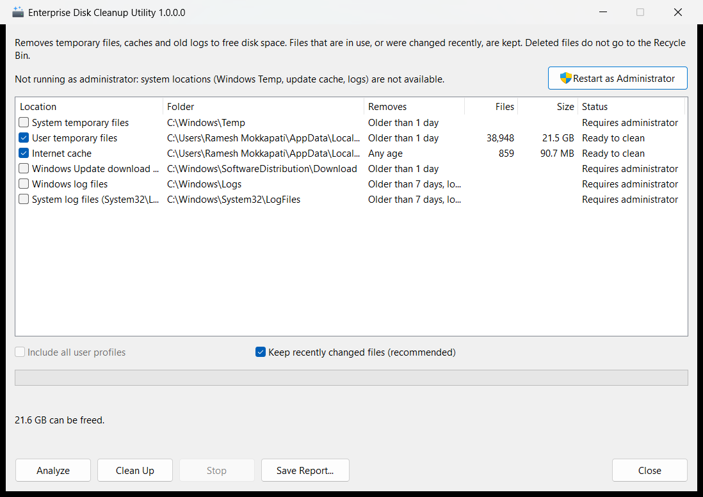

# WinDiskCleaner – Enterprise Disk Cleanup Utility (C++ / MFC)

Removes temporary files, Windows Update downloads, browser caches and old system logs, either from a
window or silently from SCCM, Intune or Task Scheduler. Built from `disk_cleanup_utility_runbook.md`.



## What it cleans

| Location | Folder | Mode | Removes |
|---|---|---|---|
| System temporary files | `%WINDIR%\Temp` | standard | files older than 1 day |
| User temporary files | `%LOCALAPPDATA%\Temp` | standard | files older than 1 day |
| Internet cache | `%LOCALAPPDATA%\Microsoft\Windows\INetCache` | standard | any age |
| Windows Update download cache | `%WINDIR%\SoftwareDistribution\Download` | `/DEEP` | files older than 1 day |
| Windows log files | `%WINDIR%\Logs` | `/DEEP` | `.log .lo_ .etl .old .bak .cab .txt` older than 7 days, never `MeasuredBoot\` |
| System log files | `%WINDIR%\System32\LogFiles` | `/DEEP` | same types, older than 7 days, never `Sum\` or `WMI\` |

`/ALLUSERS` adds the user Temp and Internet cache of every local profile, which is useful when the task runs as SYSTEM.

### Safety rules

- **Recent files are kept.** A file is only removed when both its creation and modification times are older than the location's minimum age. `/MINAGE:hours` overrides this; in the window, untick *Keep recently changed files*.
- **Files in use are skipped.** A sharing or lock violation (`0x20`) is counted and reported, not treated as an error.
- **Links are never followed.** Junctions, symlinks and mount points inside a location are skipped, so a link in Temp pointing elsewhere can't cause deletions outside it.
- **Unsafe locations are refused.** A location that is itself a link, a drive root, a relative path or a network path is refused.
- **Folders are left in place.** The location folder is never removed. Sub-folders are removed only when empty and older than the minimum age.
- **No Recycle Bin.** Deleted files are permanently removed. Run `/REPORT` first to see what would go.

## Usage

```bash
WinDiskCleaner.exe
```

```bash
WinDiskCleaner.exe /SILENT /AUTO
```

```bash
WinDiskCleaner.exe /SILENT /DEEP /LOG:"C:\ProgramData\DiskCleaner\Logs\cleanup_last_run.log"
```

| Switch | Meaning |
|---|---|
| *(none)* | Open the window. **Analyze** measures, **Clean Up** asks for confirmation then deletes. |
| `/SILENT` | No window. Writes the log and returns an exit code. On its own it implies `/AUTO`. |
| `/AUTO` | Clean the standard locations. Without `/SILENT` the window opens and cleans straight away, without confirmation. |
| `/DEEP` | Also clean the Windows Update cache and the old logs. |
| `/REPORT` | Measure only: nothing is deleted. |
| `/ALLUSERS` | Include every local user profile (needs administrator rights). |
| `/MINAGE:hours` | Override every location's minimum age. |
| `/LOG:"path"` | Report file. `/SILENT` defaults to `%ProgramData%\DiskCleaner\Logs\cleanup_last_run.log`. |
| `/?` | Show the switches. |

**Exit codes** (`/SILENT`):

| Code | Meaning |
|---|---|
| 0 | Success. Files in use were skipped, as expected. |
| 2 | A location could not be opened. Run elevated, or as SYSTEM. |
| 3 | Invalid command line |
| 4 | Another instance is running. The global mutex also covers SYSTEM tasks in session 0. |
| 5 | Cleanup ran, but the log could not be written |

**Scheduled task** (runbook §4.1), from an elevated prompt:

```bash
schtasks /Create /TN "Enterprise_Disk_Cleanup_Daily" /TR "\"C:\Program Files\EnterpriseUtils\WinDiskCleaner.exe\" /SILENT /AUTO" /SC DAILY /ST 03:00 /RU SYSTEM /RL HIGHEST
```

The exe runs as the invoking user (`asInvoker`). A standard user can clean their own Temp and cache. System locations need elevation; the window offers **Restart as Administrator**.

**Crash dumps:** an unhandled exception writes `%LOCALAPPDATA%\CrashDumps\WinDiskCleaner.exe.dmp` (runbook §6.2). Send it with the matching `WinDiskCleaner.pdb` from the release zip.

## Build

Requires Visual Studio 2022 with *Desktop development with C++* and *C++ MFC for latest v143 build tools*.

```bash
"C:/Program Files/Microsoft Visual Studio/2022/Community/MSBuild/Current/Bin/MSBuild.exe" WinDiskCleaner.sln -m -p:Configuration=Release -p:Platform=x64
```

Output: `bin\x64\Release\WinDiskCleaner.exe`.

- **No redistributable needed:** MFC and the CRT are linked statically.
- **Windows 7 support:** the code targets the Windows 7 API level (`_WIN32_WINNT=0x0601`), and the manifest declares support for Windows 7 through Windows 11 and Server 2012 through 2022.
- **32-bit builds:** these read `System32\LogFiles` through `Sysnative`, so 64-bit Windows doesn't redirect them to SysWOW64.

## Tests

```bash
bin/x64/Debug/CleanerTests.exe
```

```bash
powershell -ExecutionPolicy Bypass -File Tests/SmokeTest.ps1 -Configuration Debug -Platform x64
```

- **`CleanerTests.exe`** builds throw-away folders under `%TEMP%`. It checks the deletion rules: age, read-only files, locked files, junctions inside a location and as the location itself, extension filters, excluded folders, empty-folder removal and unsafe roots. It also covers the target list, the command-line parser and the report.
- **`SmokeTest.ps1`** never deletes anything. It runs the real exe in `/REPORT` mode and checks the exit codes, the single-instance refusal, and that the window opens and closes.

CI (`.github/workflows/build.yml`) builds Debug and Release for x64 and x86, and runs both test suites. Every green push to `main` is published as release `v1.0.<run>`, with `WinDiskCleaner-x64.zip` and `WinDiskCleaner-x86.zip`.

## Layout

| Folder | Contents |
|---|---|
| `Core/` | Plain Win32 code shared by the app and the tests. `CleanupEngine` scans and deletes, `CleanupTargets` holds the location list, plus `CommandLine` and `Report`. |
| `App/` | The MFC app: single instance, silent mode, the dialog with its worker thread, and the crash handler. |
| `Tests/` | `CleanerTests` (console) and `SmokeTest.ps1` |
